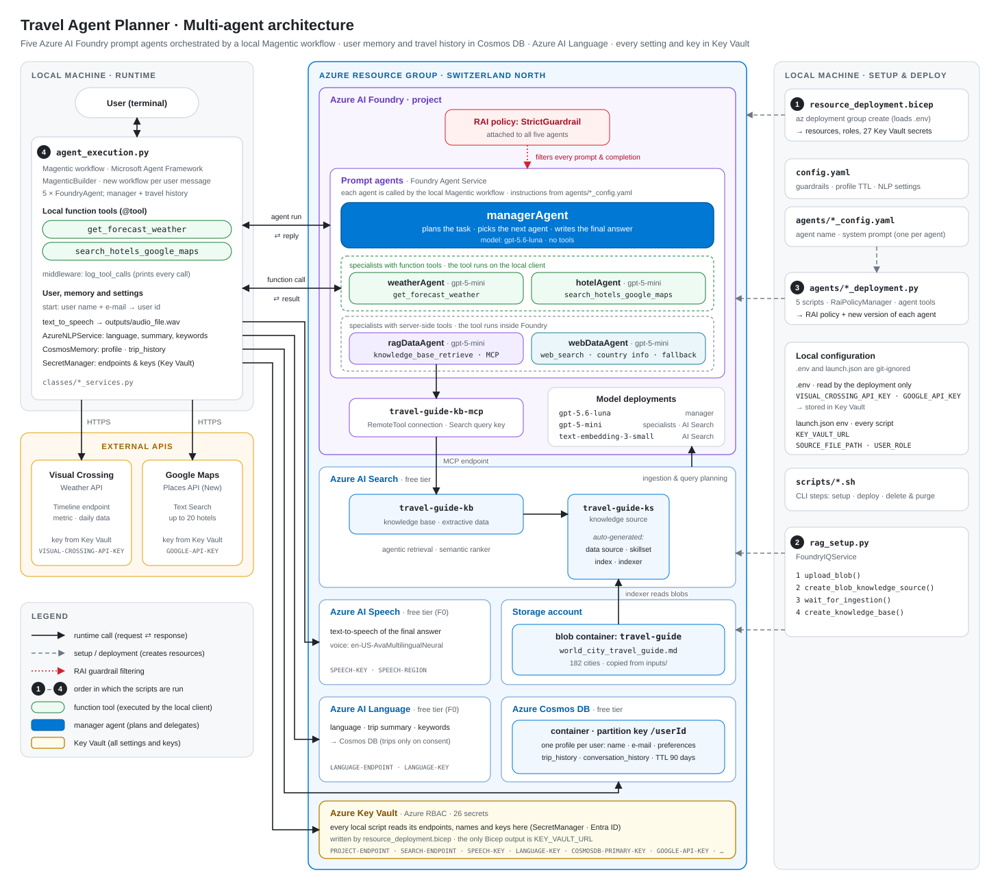
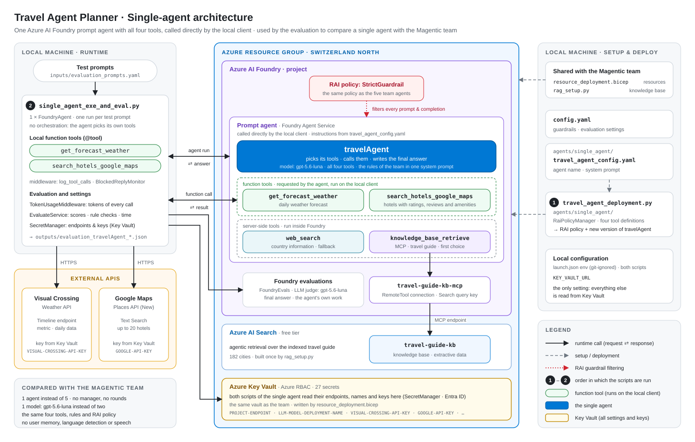

# Travel Agent Planner

This project contains **two approaches** to the same travel assistant. They are built side by side so that they can be compared and the better one chosen:

1. **Multi-agent orchestration.** A manager agent and four specialist agents, each with one tool. This approach is more expensive and slower, because every request takes many model calls. In return it is more deterministic: each tool is encapsulated in its own agent with narrow instructions.
2. **Single agent.** One agent with all four tools. This approach is cheaper and faster, but carries a higher risk of non-deterministic behaviour, because one prompt holds every rule and every tool. Its low cost makes a stronger model such as `gpt-5.6-terra` affordable, and a stronger model makes the agent considerably more reliable. Running the whole team on such a model would be too expensive.

The rest of this introduction describes the multi-agent approach, which the chat uses. The single agent is described [below](#single-agent-variant).

An AI assistant that helps you plan a trip to a chosen destination anywhere in the world. A **manager agent** plans the work and delegates it to four **specialist agents**, all hosted server-side in **Azure AI Foundry Agent Service**:

- a knowledge base agent that uses **Foundry IQ** as a RAG knowledge base: a travel guide covering 182 cities in Europe, Asia and the Americas, indexed with Azure AI Search
- a web search agent, used for general country information such as visa requirements, and as a fallback for anything the knowledge base does not cover, such as current events
- a weather agent that fetches **weather data** from the Visual Crossing API
- a hotel agent that **searches for hotels** on Google Maps through the Places API and picks the ones that best match what the user is looking for

The team uses **two LLMs**: `gpt-5.6-luna` for the manager, which does the planning and writes the final answer, and `gpt-5-mini` for the four specialist agents.

A typical answer includes a weather summary for the travel dates, a day-by-day plan based on the travel guide, hotel suggestions with ratings, the reasons why they match the user's preferences and links (when the user asks about accommodation), and transport and practical tips. The final answer is also read out with **Azure AI Speech** and saved as an audio file.

Every user signs in with a name and an e-mail address. Their profile, preferences, travel history and conversation history (in a chat fine-tuning format) are kept in **Azure Cosmos DB**. **Azure AI Language** detects the language of each question and stores it as a preference, and after every answer it summarises the trip and extracts keywords, which are saved only when the user accepts. The manager gets this short travel history as context in the next conversations. All endpoints, resource names and keys live in **Azure Key Vault**, so the only setting a script needs is the Key Vault URL.



### Single-agent variant

The repository also contains `travelAgent`: **one prompt agent** on `gpt-5.6-luna` that does the work of the whole team. It has all four tools (knowledge base, web search, weather, hotel search) and one system prompt with the same rules as the team. There is no manager and no orchestration: the local client calls the agent once, and the agent itself decides which tools to call and writes the final answer. This takes far fewer model calls than the manager's planning and progress checks plus the specialists' turns.

The chat does not use `travelAgent`. It exists so that the [evaluation](#evaluation) can run the same test prompts through both set-ups and compare answer quality, time and token usage. It reuses the team's Azure resources, knowledge base and RAI policy, and has no user memory, language detection or speech.



## Table of contents

1. [Repository layout](#repository-layout)
2. [Local setup](#local-setup)
3. [Infrastructure: `resource_deployment.bicep`](#infrastructure-resource_deploymentbicep)
4. [The agents](#the-agents)
5. [Tools](#tools)
6. [User memory, language detection and travel history](#user-memory-language-detection-and-travel-history)
7. [Evaluation](#evaluation)
8. [Guardrail configuration: `StrictGuardrail`](#guardrail-configuration-strictguardrail)
9. [Clean-up](#clean-up)

---

## Repository layout

| Path | Purpose |
|---|---|
| `resource_deployment.bicep` | Azure infrastructure: Foundry resource and project, model deployments, AI Search, Storage, Speech, Language, Cosmos DB, Key Vault with all settings and keys, knowledge base connection and role assignments |
| `rag_setup.py` | Uploads the travel guide and builds the Foundry IQ knowledge source and knowledge base |
| `agents/<agent>_deployment.py` | One script per agent. Creates or updates the RAI policy and the server-side agent (system prompt and tools) |
| `agents/<agent>_config.yaml` | One file per agent: agent name and system prompt |
| `agent_execution.py` | Interactive command-line chat. Asks for the user name and e-mail address, builds the Magentic workflow, asks the user to approve the manager's plan, runs the weather, hotel search and hotel review tools locally, saves the conversation and preferences to Cosmos DB, converts the final answer to speech and offers to save a trip summary and keywords |
| `magentic_exe_and_eval.py` | Runs the test prompts through the Magentic workflow, evaluates every run and saves the report in `outputs/` |
| `single_agent_exe_and_eval.py` | The same evaluation for the single agent `travelAgent` |
| `agents/single_agent/` | Deployment script and config file (agent name and system prompt) of the single agent `travelAgent` |
| `config.yaml` | Guardrail (RAI) settings shared by all agents, profile TTL for Cosmos DB, the travel history limits, the tracing settings, the NLP sentiment threshold and the evaluation settings |
| `classes/evaluate_services.py` | `EvaluateService`: Foundry evaluators for the final answer and for every agent, rule checks, token counting and the report, for a workflow or a single agent. `TokenUsageMiddleware`: records the token usage of every agent call |
| `classes/secret_manager_services.py` | `SecretManager`: reads secrets from Key Vault and caches them in memory |
| `classes/cosmos_memory_services.py` | `CosmosMemory`: user profiles, preferences, travel history and conversation history in Cosmos DB |
| `classes/travel_history_provider.py` | `TravelHistoryProvider`: Agent Framework context provider that gives the manager the user's saved travel history |
| `classes/azure_nlp_services.py` | `AzureNLPService`: language detection, summarization, key phrases and other Azure AI Language features |
| `classes/foundry_iq_services.py` | `FoundryIQService`: blob upload, knowledge source, ingestion, knowledge base, MCP tool |
| `classes/weather_services.py` | `WeatherService` and the `get_forecast_weather` / `get_current_weather` tools |
| `classes/google_services.py` | `GooglePlacesService` (Google Maps Places API) and the `search_hotels_google_maps` tool |
| `classes/human_review_services.py` | Human in the loop for the chat: `review_plan` (plan review in the console), the `ask_user_about_hotels` tool and its evaluation stand-in `approve_hotels_automatically` |
| `classes/speech_services.py` | `AzureSpeechService` and the `text_to_speech` helper |
| `classes/rai_policies_services.py` | `RaiPolicyManager`: builds and deploys the RAI policy from `config.yaml` |
| `utils/utils.py` | `add_todays_date`, which puts today's date in front of every task, and helpers for normalising weather API responses |
| `utils/split_travel_guide.py` | Splits `inputs/world_city_travel_guide.md` into one file per city in `inputs/travel_guide/`, the input of `rag_setup.py` |
| `utils/agent_middleware.py` | Middleware shared by the run scripts: `log_tool_calls`, `log_manager_decisions`, `log_agent_replies`, `BlockedReplyMonitor` and `drop_foreign_tool_contents` |
| `utils/observability.py` | `enable_tracing`: sends the OpenTelemetry traces of the chat or an evaluation run to Application Insights (see [Tracing](#tracing)) |
| `inputs/` | Source documents for the knowledge base: `travel_guide/` (the guide split into one file per city, uploaded by `rag_setup.py`) and the full guide it was split from (`world_city_travel_guide.md`, `.pdf`) and the test prompts for the evaluation (`evaluation_prompts.yaml`) |
| `outputs/` | Audio file with the spoken final answer and the evaluation reports (`evaluation_<workflow>_<timestamp>.json`) |
| `scripts/` | Step-by-step CLI commands for environment setup, deployment and deletion |
| `docs/` | The two architecture diagrams shown at the top of this README |

---

## Local setup

### Prerequisites

- Python 3.10 or later (developed with Python 3.13)
- [Azure CLI](https://aka.ms/installazurecli) with Bicep
- An Azure subscription where you can create resource groups and role assignments (for example, Owner)
- A [Visual Crossing](https://www.visualcrossing.com/weather-api) API key for weather data
- A [Google Maps Platform](https://console.cloud.google.com/google/maps-apis/start) API key with **Places API (New)** enabled, for hotel search (see [Hotel search tool](#hotel-search-tool-classesgoogle_servicespy))

The template uses free tiers, and Azure allows **one of each per subscription**: a free (F0) Speech resource, a free (F0) Language resource, a free Azure AI Search service and a Cosmos DB account with the free tier. If one of them already exists, or a Speech or Language resource is still soft-deleted, the deployment fails (for example with `CanNotCreateMultipleFreeAccounts`). See [Clean-up](#clean-up) for how to purge soft-deleted resources.

> The commands in `scripts/*.sh` use PowerShell line continuation (`` ` ``). Run them in PowerShell, or replace the backticks with `\` in bash.

### 1. Python environment

```powershell
python -m venv tutorials
tutorials\Scripts\activate
pip install -r requirements.txt
```

### 2. Azure CLI login and Bicep

```powershell
az login
az bicep install
az bicep upgrade
```

### 3. Add the third-party API keys to `.env`

Create a `.env` file in the repository root. It is listed in `.gitignore`, so **never commit it**. It holds only the two keys that do not come from Azure:

```dotenv
VISUAL_CROSSING_API_KEY="<your Visual Crossing key>"
GOOGLE_API_KEY="<your Google Maps Platform key>"
```

The deployment passes them to the template as `@secure()` parameters, and the template stores them in Key Vault. The Python code never reads `.env`.

### 4. Deploy the Azure resources

Choose a unique prefix. Resource names, including the globally unique storage account, Key Vault and Cosmos DB names, are derived from it. All resources are created in the resource group's region (see [Region](#region)).

```powershell
az group create --name <resource-group> --location switzerlandnorth

# Load .env into this PowerShell session (Bicep cannot read the file itself)
Get-Content .env | ForEach-Object {
  if ($_ -match '^\s*([A-Za-z_][A-Za-z0-9_]*)\s*=\s*(.*)$') {
    Set-Item "env:$($Matches[1])" $Matches[2].Trim().Trim('"', "'")
  }
}

az deployment group create `
  --resource-group <resource-group> `
  --template-file resource_deployment.bicep `
  --parameters projectPrefix="<prefix>" `
    userPrincipalId="$(az ad signed-in-user show --query id -o tsv)" `
    visualCrossingApiKey="$env:VISUAL_CROSSING_API_KEY" `
    googleApiKey="$env:GOOGLE_API_KEY"

# The only output is KEY_VAULT_URL
az deployment group show `
  --resource-group <resource-group> `
  --name resource_deployment `
  --query properties.outputs
```

Good to know:

- **Preview before deploying.** Add `--confirm-with-what-if` to `az deployment group create` to see what will be created or changed and confirm with `y/n`. Secrets that hold keys always show as *Modify*, because what-if cannot evaluate `listKeys()` or secure parameters. Their values don't actually change.
- **Running the deployment again is safe.** The default mode is incremental: resources that already exist with the same settings are left unchanged, and only missing ones are created. Properties changed by hand in the portal are reset to the values in the template.
- **`InsufficientResourcesAvailable`** means the region has no capacity left for a new service of that type (most often the free Azure AI Search tier). Choose another region (see [Region](#region)).

### 5. Configure the local settings

Every script reads its endpoints, names and keys from Key Vault when it starts. It only needs the following environment variables:

| Variable | Used by | Required | Description |
|---|---|---|---|
| `KEY_VAULT_URL` | all scripts | yes | `KEY_VAULT_URL` output of the deployment, for example `https://<prefix>-kv.vault.azure.net/` |
| `SOURCE_FOLDER_PATH` | `rag_setup.py` | yes | `inputs/travel_guide`: every `.md` file in it is uploaded |
| `KNOWLEDGE_SOURCE_NAME` | `rag_setup.py` | no | Default `travel-guide-ks` |
| `USER_ROLE` | `agent_execution.py` | no | Stored in the profile of a new user, for example `Traveler` |

None of them is secret. In VS Code, set them in the `env` section of each configuration in `.vscode/launch.json` (git-ignored), for example:

```jsonc
{
  "name": "Python Debugger: Agent Execution",
  "type": "debugpy",
  "request": "launch",
  "program": "${workspaceFolder}/agent_execution.py",
  "env": {
    "KEY_VAULT_URL": "https://<prefix>-kv.vault.azure.net/",
    "USER_ROLE": "Traveler"
  }
}
```

The template gives your account the `Key Vault Secrets User` role. Role assignments can take a few minutes to take effect, so a `403 Forbidden` from Key Vault right after the deployment usually disappears on its own.

### 6. Build the knowledge base

```powershell
python utils/split_travel_guide.py   # on a fresh clone and after a change to inputs/world_city_travel_guide.md
python rag_setup.py
```

`split_travel_guide.py` writes one file per city to `inputs/travel_guide/` and replaces what was there, so cities removed from the guide disappear. It writes nothing if the files do not add up to the guide. The files are UTF-8 with a BOM: without it the indexer guesses the encoding, and it read two of the short files (Kraków, Florianópolis) as GBK. `inputs/` is git-ignored, so the city files are not in the repository: a fresh clone has to run the split first. The files already tracked there (the full guide, the PDF and `evaluation_prompts.yaml`) stay tracked.

This uploads every file of the travel guide folder to Blob Storage and deletes blobs that are no longer in the folder, creates the knowledge source (Azure AI Search then generates the data source, skillset, index and indexer), runs the indexer and waits for that run (up to 30 minutes), deletes the chunks of removed blobs, and creates the knowledge base. It stops before the knowledge base if the run had errors or truncated a file.

### 7. Deploy the agents

Run all five scripts. The order does not matter.

```powershell
python agents/manager_agent_deployment.py
python agents/rag_data_agent_deployment.py
python agents/web_data_agent_deployment.py
python agents/weather_agent_deployment.py
python agents/hotel_agent_deployment.py
```

Each script creates or updates the `StrictGuardrail` RAI policy, then creates a new version of its agent with the system prompt, tools and policy attached.

Optional: deploy the single agent `travelAgent`, which only the [evaluation](#evaluation) uses.

```powershell
python agents/single_agent/travel_agent_deployment.py
```

> Run the scripts by path, as shown. `python -m agents.<script>` does not work when the `openai-agents` package is installed, because that package is also imported as `agents`.

### 8. Chat with the agents

```powershell
python agent_execution.py
```

The chat first asks for your **user name** and then for your **e-mail address**, and does not start the agents until you give both. A known name loads your existing profile, and a new name creates one. A returning user can press Enter to keep the stored e-mail address (see [User memory, language detection and travel history](#user-memory-language-detection-and-travel-history)).

After every answer the chat shows a short summary of the trip and keywords from your question and asks `Save them to your profile for your next trips? [y/N]`. Only what you accept is saved and given to the manager in later conversations.

Type your questions at the `You:` prompt. Type `exit` or `quit`, or press `Ctrl+C`, to end the session. The console shows what the team is doing in `[TOOL]`, `[MANAGER]` and `[AGENT]` lines (see [Orchestration](#orchestration-agent_executionpy)).

Each message is handled as a separate task and **the team does not remember earlier messages** (only the saved travel history), so put everything the team needs (destination, dates, budget, interests) in one message. An answer takes longer than with a single agent, because the manager and the specialists make several model calls per message.

Example prompt:

```text
I'm going to Lisbon from 2026-10-12 to 2026-10-15 on a medium budget. I like food and museums. Can you plan my trip?
```

Example prompt with hotel search:

```text
I'm going to Lisbon from 2026-10-12 to 2026-10-15. Can you plan my trip and suggest a few quiet hotels near the city centre?
```

Describe the hotel you want (location, style, amenities, who travels): the hotel agent passes the description to the search and picks the hotels that match it best. The search has no room prices and no availability for the travel dates, so the answer points you to the hotel's website for them.

The chat stops twice to ask you (see [Human in the loop](#human-in-the-loop)):

- **`PLAN:`** before any agent runs. Press Enter (or `y`/`t`) to start, or type what to change, for example "skip the weather, add hotels near the beach". The manager plans again and shows the new plan.
- **`HOTEL REVIEW:`** after the hotel agent has chosen hotels. Press Enter to accept, `n` to get other hotels, or type what you want instead, for example "closer to the beach". The agent chooses once more and does not ask again.

### 9. Evaluate the agents

```powershell
python magentic_exe_and_eval.py        # the Magentic team
python single_agent_exe_and_eval.py    # the single agent (deploy travelAgent first, see step 7)
```

Both scripts need only `KEY_VAULT_URL`. They run the test prompts from `inputs/evaluation_prompts.yaml`, score every answer and save a report in `outputs/`. See [Evaluation](#evaluation) for the metrics and the report.

---

## Infrastructure: `resource_deployment.bicep`

The template is based on the [Foundry basic setup sample](https://github.com/microsoft-foundry/foundry-samples/blob/main/infrastructure/infrastructure-setup-bicep/00-basic/main.bicep) and extended with the RAG components, Speech, Language, Cosmos DB and Key Vault.

### Region

The scripts use **Switzerland North**, the region closest to Poland that supports every service in this project. Regions that were checked against the Microsoft Learn region tables:

| Region | Why it is not used |
|---|---|
| Poland Central | No Azure AI Speech |
| Sweden Central, Germany West Central, West Europe, North Europe | Marked *high demand* for Azure AI Search: new search services can't be created |
| Italy North, Norway East | No semantic ranker / agentic retrieval on the free Search tier |

France Central and UK South support everything too. Regional capacity changes over time, so check the [Azure AI Search region list](https://learn.microsoft.com/azure/search/search-region-support) if a deployment fails with `InsufficientResourcesAvailable`.

To use another region, change `--location` in `az group create`. Existing resources can't be moved to another region: delete the resource group, purge the soft-deleted resources (see [Clean-up](#clean-up)) and deploy again.

### Parameters

| Parameter | Default | Description |
|---|---|---|
| `projectPrefix` | *(required)* | Base name for all resources |
| `userPrincipalId` | *(required)* | Object ID of the user who runs the scripts (`az ad signed-in-user show --query id -o tsv`) |
| `visualCrossingApiKey` | *(required, secure)* | Visual Crossing API key, stored in Key Vault |
| `googleApiKey` | *(required, secure)* | Google Maps Platform API key, stored in Key Vault |
| `aiFoundryName` | `projectPrefix` | Foundry (AIServices) account name and custom subdomain |
| `aiProjectName` | `<aiFoundryName>-proj` | Foundry project name |
| `llmModelDeploymentName` | `<prefix>-llm-deploy` | `gpt-5.6-luna` deployment, used by the manager agent |
| `llmTerraModelDeploymentName` | `<prefix>-llm-terra-deploy` | `gpt-5.6-terra` deployment, a stronger model that no script uses yet |
| `llmMiniModelDeploymentName` | `<prefix>-llm-mini-deploy` | `gpt-5-mini` deployment, used by the specialist agents and the knowledge base |
| `embeddingModelDeploymentName` | `<prefix>-embedding-deploy` | Embedding model deployment |
| `aiSearchName` | `<prefix>-aisearch` | Azure AI Search service |
| `storageName` | `<prefix>st` (lowercase, no hyphens, max 24 chars) | Storage account |
| `blobContainerName` | `travel-guide` | Container with the source documents |
| `knowledgeBaseName` | `travel-guide-kb` | Must match the knowledge base created by `rag_setup.py` |
| `knowledgeBaseConnectionName` | `<knowledgeBaseName>-mcp` | Project connection used by the knowledge base agent's MCP tool |
| `speechName` | `<prefix>-speech` | Speech resource name and custom subdomain |
| `languageName` | `<prefix>-language` | Language resource name and custom subdomain |
| `cosmosDbAccountName` | `<prefix>-cosmos` | Cosmos DB account |
| `databaseName` | `<prefix>-cosmosdb` | Cosmos DB database |
| `containerName` | `<prefix>-container` | Cosmos DB container with the user profiles |
| `keyVaultName` | first 21 characters of the prefix + `-kv` (max 24 chars) | Key Vault |
| `logAnalyticsName` | `<prefix>-law` | Log Analytics workspace that stores the traces |
| `appInsightsName` | `<prefix>-appi` | Application Insights resource |
| `appInsightsConnectionName` | `<appInsightsName>-connection` | Project connection to Application Insights |
| `logAnalyticsDailyQuotaGb` | `'0.15'` | Daily ingestion cap of the workspace in GB. A string, because Bicep has no decimal numbers |
| `location` | resource group location | Azure region for all resources |

### Resources

| Resource | Details |
|---|---|
| **Azure AI Foundry account** (`Microsoft.CognitiveServices/accounts`, kind `AIServices`, SKU `S0`) | System-assigned identity, project management enabled, custom subdomain. Local (key) auth stays enabled because Azure AI Search calls the models with an API key. |
| **Foundry project** | Logical container for the agents, connections and deployments. |
| **LLM deployment**: `gpt-5.6-luna` (2026-07-09) | `GlobalStandard`, 1,000K TPM. Used by `managerAgent`, by the single agent `travelAgent` and as the LLM judge of the evaluation. |
| **LLM deployment**: `gpt-5.6-terra` (2026-07-09) | `GlobalStandard`, 1,000K TPM. Stronger and about 10 times more expensive per token than `gpt-5.6-luna`. No script uses it yet; a deployment costs nothing until it is called. |
| **LLM deployment**: `gpt-5-mini` (2025-08-07) | `GlobalStandard`, 1,000K TPM. Used by the four specialist agents, and by AI Search for ingestion and query planning. Deployed after the first LLM to avoid parallel deployment conflicts. |
| **Embedding deployment**: `text-embedding-3-small` | `GlobalStandard`, 50K TPM (1536 dimensions). Used to vectorise the travel guide. Deployed after the LLMs. |
| **Azure AI Search** | `free` SKU, semantic ranker `free` (required by agentic retrieval). Accepts both Entra ID (for the user) and API keys (for services). |
| **Storage account + blob container** | `StorageV2`, `Standard_LRS`, TLS 1.2, no public blob access. Shared-key access is enabled because the Search indexer reads the container with the account key. |
| **Knowledge base connection** (`RemoteTool`, `CustomKeys`) | Project connection pointing at the knowledge base MCP endpoint (`.../knowledgebases/<kb>/mcp`). It stores the read-only Search **query key**, which is read from the search service at deployment time, so the key never appears in code or outputs. It can be created before the knowledge base exists. |
| **Azure AI Speech** (kind `SpeechServices`, SKU `F0`) | Free tier, custom subdomain, key auth. Converts the final answer to speech. |
| **Azure AI Language** (kind `TextAnalytics`, SKU `F0`) | Free tier, custom subdomain, key auth. Detects the language of the user's questions, summarises each trip and extracts its keywords. |
| **Azure Cosmos DB** (NoSQL API) | Free tier, `Session` consistency, single region. The database has 1,000 RU/s of shared throughput (covered by the free tier). The container is partitioned by `/userId`, has a default TTL of 90 days and a composite index on `userId` and `last_updated`. |
| **Azure Key Vault** | `standard` SKU, Azure RBAC authorization, soft delete for 7 days. Purge protection is off so that the vault name can be reused after a clean-up; it is commented out in the template and should be enabled in production. Holds all settings and keys (see below). |
| **Log Analytics workspace** | `PerGB2018` (pay-as-you-go), 30 days retention (included in the ingestion price), daily ingestion cap of 0.15 GB. No fixed cost: ingestion is billed per GB (3.29 USD in Switzerland North in October 2026) after the free 5 GB a month per billing account. 0.15 GB a day is about 4.5 GB a month, so the cap keeps the project in the free allowance as long as no other workspace of the billing account uses it. When the cap is reached, the workspace collects nothing until the next day (UTC). |
| **Application Insights** | Workspace-based (`IngestionMode: LogAnalytics`): its data is stored and billed in the workspace above, the resource itself costs nothing. |
| **Application Insights connection** (`AppInsights`, `ApiKey`) | Project connection that holds the Application Insights connection string. `FoundryAgent.configure_azure_monitor()` reads it (the SDK accepts one such connection per project), and the Foundry portal shows the project's traces under **Tracing**. Created after the knowledge base connection, one connection write at a time. |

### Key Vault secrets

The template writes **26 secrets**. A secret name is the setting name with `-` instead of `_`, because Key Vault names can't contain underscores (for example `PROJECT_ENDPOINT` → `PROJECT-ENDPOINT`). Keys are read from the resources during the deployment (`listKeys()`), so they never appear in code, outputs or the deployment history.

| Group | Secrets | Read by |
|---|---|---|
| Foundry | `PROJECT-ENDPOINT` | agent deployment scripts, `agent_execution.py`, both evaluation scripts |
| | `LLM-MODEL-DEPLOYMENT-NAME`, `LLM-MINI-MODEL-DEPLOYMENT-NAME` | agent deployment scripts (`rag_setup.py` also reads the mini model) |
| | `LLM-TERRA-MODEL-DEPLOYMENT-NAME` | not read by any script yet |
| | `AOAI-ENDPOINT`, `EMBEDDING-MODEL-DEPLOYMENT-NAME` | `rag_setup.py` |
| RAI policy (management plane) | `AZURE-SUBSCRIPTION-ID`, `AZURE-RESOURCE-GROUP`, `AZURE-COGNITIVE-ACCOUNT-NAME` | agent deployment scripts |
| Knowledge base | `SEARCH-ENDPOINT`, `KNOWLEDGE-BASE-NAME` | `rag_setup.py`, `rag_data_agent_deployment.py` |
| | `KNOWLEDGE-BASE-CONNECTION-NAME` | `rag_data_agent_deployment.py` |
| | `STORAGE-ACCOUNT-URL`, `BLOB-CONTAINER-NAME` | `rag_setup.py` |
| Keys AI Search uses in the background | `AOAI-API-KEY`, `STORAGE-CONNECTION-STRING` | `rag_setup.py` (passed to the knowledge source) |
| Speech | `SPEECH-KEY`, `SPEECH-REGION` | `speech_services.py` |
| Language | `LANGUAGE-ENDPOINT`, `LANGUAGE-KEY` | `agent_execution.py` |
| Cosmos DB | `COSMOSDB-ENDPOINT`, `COSMOSDB-DATABASE-NAME`, `COSMOSDB-CONTAINER-NAME`, `COSMOSDB-PRIMARY-KEY` | `agent_execution.py` |
| Third-party APIs | `VISUAL-CROSSING-API-KEY`, `GOOGLE-API-KEY` | `weather_services.py`, `google_services.py` |

Each script creates a `SecretClient` with `DefaultAzureCredential` and wraps it in `SecretManager`, which caches every secret in memory for the lifetime of the process.

### Authentication model

The project uses a hybrid approach:

- **User → Azure (Entra ID).** All scripts use `DefaultAzureCredential` (`az login`) for Key Vault, the Foundry project and agents, Blob Storage, Azure AI Search and the RAI policy. The template assigns the user these roles:
  - `Key Vault Secrets User` on the Key Vault (read the settings and keys)
  - `Storage Blob Data Contributor` on the storage account (upload documents)
  - `Search Service Contributor` on the search service (create knowledge sources and knowledge bases)
  - `Search Index Data Contributor` on the search service (read index content and status)
- **User → Azure (keys from Key Vault).** The local client calls Speech, Language and Cosmos DB with keys that it reads from Key Vault. The weather and hotel tools read the Visual Crossing and Google Maps keys the same way.
- **Service → service (keys).** AI Search reads Storage with the account connection string and calls the models with the Foundry API key. The knowledge base agent queries the knowledge base with the Search query key stored in the project connection.

Even though most services are called with keys, Key Vault itself is always opened with Entra ID, so no secret is stored on disk except the two third-party keys in `.env`, which are only needed for the deployment.

Role assignments for a fully managed-identity setup (Search → Storage, Search → Foundry, project → Search) are included in the template but commented out. The free Search tier does not support managed identities.

---

## The agents

All five agents are **prompt agents** (`PromptAgentDefinition`) hosted in Azure AI Foundry Agent Service. Each specialist has exactly one tool.

| Agent | Model | Tool | Role |
|---|---|---|---|
| `managerAgent` | `gpt-5.6-luna` | none | Plans the task, picks the next agent, checks progress and writes the final answer |
| `ragDataAgent` | `gpt-5-mini` | `knowledge_base_retrieve` | Attractions, restaurants, events, transport and practical tips from the travel guide. First choice for destination information |
| `webDataAgent` | `gpt-5-mini` | `web_search` | General country information such as entry and visa rules, and fallback for information the knowledge base did not return |
| `weatherAgent` | `gpt-5-mini` | `get_forecast_weather` | Daily weather forecast for the destination and dates |
| `hotelAgent` | `gpt-5-mini` | `search_hotels_google_maps`, `ask_user_about_hotels` | The hotels that best match the user's preferences, with ratings, reasons and links |

### Deployment (`agents/<agent>_deployment.py`)

Each script does the same four things for its own agent:

1. Reads its settings from Key Vault, `config.yaml` (guardrails) and its own `<agent>_config.yaml` (agent name and system prompt).
2. Creates or updates the RAI policy through `RaiPolicyManager` and gets a `RaiConfig` back.
3. Defines the agent's tool (see [Tools](#tools)). The manager has none.
4. Calls `project_client.agents.create_version(...)`, which creates a new agent version with the instructions, tool and RAI config.

The manager script takes its model from the `LLM-MODEL-DEPLOYMENT-NAME` secret. The four specialist scripts take theirs from `LLM-MINI-MODEL-DEPLOYMENT-NAME`.

### Orchestration (`agent_execution.py`)

The orchestration runs **on the client**. The agents never call each other. The local Magentic workflow (`MagenticBuilder` from Microsoft Agent Framework) calls each server-side agent through a `FoundryAgent` client.

Before the first message, the chat asks for the user name, loads or creates the user's profile in Cosmos DB, asks for the e-mail address and reads the user's saved travel history. For every user message the workflow then does the following:

1. **Plan.** The manager collects the known facts and writes a plan for the team. The chat shows the plan, and the user approves it or types corrections; a correction makes the manager plan again (see [Human in the loop](#human-in-the-loop)).
2. **Check progress.** At the start of each round the manager answers: is the request satisfied, is progress being made, which agent goes next and with what instruction.
3. **Delegate.** The chosen specialist runs with that instruction. Its reply is shared with the other agents.
4. **Answer.** When the manager judges the request satisfied, it writes the final answer from the collected results.

After the answer is printed, `save_response_and_preferences()` stores the question and answer in the user's conversation history and saves the detected language, `text_to_speech()` reads the answer out, and `propose_trip_memory()` offers to save a trip summary and keywords (see [Travel history](#travel-history)). All three steps are skipped when the final answer was refused or blocked (see **Refused or blocked answers** below).

Details worth knowing:

- **The manager picks agents by name and description.** Each `FoundryAgent` is created with a `description`, and the manager's system prompt lists the same team.
- **Function tools run locally.** `weatherAgent` and `hotelAgent` get the Python implementations of their tools. When the server-side agent requests a function call, `FoundryAgent` runs the local function and sends the result back. The MCP knowledge base and web search tools run entirely server-side.
- **Limits.** `max_round_count=20`: one round is one progress check plus one agent turn, and a workflow that reaches the limit ends *without* a final answer. `max_stall_count=3`: after more than three rounds without progress the manager resets the team and replans. A reset clears the shared conversation, so the manager starts again from the first agent and asks for data it already had; the round count is not reset. `max_reset_count=2`: at the second reset the workflow terminates, also *without* a final answer, instead of repeating the same rounds up to the round limit.
- **Today's date.** The agents do not know the current date, so `add_todays_date` (`utils/utils.py`) puts the line `Today's date: YYYY-MM-DD (weekday)` in front of every message. The manager uses it to turn "next week" into dates and to tell whether a trip is within the 15 days of the weather forecast. The conversation history keeps the message as the user wrote it.
- **No memory between messages.** A Magentic workflow handles exactly one task and accepts a single task message, so a new workflow is built for every user message. The conversation history in Cosmos DB is a record for fine-tuning; it isn't passed back to the agents. Only the short travel history the user accepted reaches the manager, through `TravelHistoryProvider` (see [Travel history](#travel-history)).
- **Agents share text answers only.** Magentic passes every agent's reply to the other agents, including the function call and its raw result. An agent that already has a server-side conversation would then send a tool result without the matching call, and the service rejects it with *"No tool call found for function call output"*. The `drop_foreign_tool_contents` middleware (`utils/agent_middleware.py`) on every agent removes these tool contents from the incoming messages. This also keeps raw tool output out of the other agents' context.
- **Refused or blocked answers.** A reply that the model refuses, or that the content filter cuts off on the output side, arrives without an error: the text ends early and a refusal such as *"I'm sorry, but I cannot assist with that request."* takes its place. `BlockedReplyMonitor` (`utils/agent_middleware.py`) on every agent detects this and prints `[GUARDRAIL]` lines with the refusal, the finish reason, the response status and any content filter results the service reported. No filter results usually means the model refused on its own. A blocked *input* is different: it raises `ChatClientContentFilterException`, which the chat reports as *"blocked by the content safety policy"*.
- **Console log.** `log_tool_calls` prints every local function call and a truncated result as `[TOOL] -> ...` / `[TOOL] <- ...`. `log_manager_decisions` prints the manager's decision at the start of every round as `[MANAGER] ...`: the next agent, the reason and the instruction, or that the request is satisfied. `log_agent_replies` prints what each specialist sent back as `[AGENT] <name> replied: ...`, truncated to 1,500 characters. All three are in `utils/agent_middleware.py`.

### Tracing

The console log disappears when the script ends. For a record of every run, the chat and both evaluation scripts send OpenTelemetry traces to **Application Insights**: one trace per workflow run, with the manager's calls, every specialist call, every local tool call and the Azure SDK and HTTP calls below them, each with its duration, token counts and errors.

- **Set-up.** `enable_tracing()` (`utils/observability.py`) is called once per process, at the start of the async run. It calls `FoundryAgent.configure_azure_monitor()` on one agent: the method reads the connection string from the project's Application Insights connection (see [Resources](#resources)) and sets up OpenTelemetry for the whole process, so this one call covers every agent and every workflow.
- **Where to look.** In the Foundry portal under **Tracing** (project level), or in Application Insights under *Agents* and *Transaction search*, and with KQL in the Log Analytics workspace.
- **Chat and evaluation apart.** Each script sends its traces under its own service name (`cloud_RoleName`): `travel-planner-chat`, `travel-planner-eval-magentic` and `travel-planner-eval-single-agent` (`observability.service_names` in `config.yaml`). Filter by it, so test runs do not mix with real conversations.
- **Content.** `observability.enable_sensitive_data: false` keeps the structure, durations, token counts and errors. `true` also records the prompts, answers and tool arguments and results, i.e. what the user typed: useful for debugging and demos, and more data per run.
- **Never in the way.** When tracing cannot be set up (`observability.enabled: false`, no project connection, `azure-monitor-opentelemetry` not installed), the script prints a `[TRACING]` line and runs without it. A started script prints `[TRACING] Traces go to Application Insights as '<service name>'.` when it works.
- **Cost.** The traces are billed as Log Analytics ingestion; the daily cap of the workspace keeps them in the free allowance (see [Resources](#resources)). Without sensitive data a team run is small; with it, a run can be around a megabyte, mostly the manager's growing conversation and the hotel results.
- **Server-side tools.** The knowledge base (MCP) and web search run in Foundry. The client traces show the agent call that used them; what Foundry reports about the tools themselves has not been checked yet.

#### What a trace contains

A trace is a tree of **spans**: timed operations, each with its parent. Agent Framework names its spans after the OpenTelemetry GenAI conventions: the operation, then the agent, model or tool. The span names below come from the installed `agent-framework` 1.19 and `agent-framework-orchestrations` 1.2. The nesting is simplified and has not been checked on a real run yet.

A message to the team, after the plan was approved:

```text
workflow.run                                   the Magentic workflow, one per workflow.run() call
├─ executor.process magentic_orchestrator      the orchestrator's turn
│  └─ invoke_agent managerAgent                 plan, progress check or final answer
│     └─ chat <model>                           the model call, with its token counts
├─ executor.process ragDataAgent               a specialist's turn
│  └─ invoke_agent ragDataAgent
│     └─ chat <model>                           the knowledge base (MCP) runs inside this call, in Foundry
└─ executor.process weatherAgent
   └─ invoke_agent weatherAgent
      ├─ chat <model>                           the model asks for get_forecast_weather
      ├─ execute_tool get_forecast_weather      the local function tool
      │  └─ GET weather.visualcrossing.com      the HTTP call below it
      └─ chat <model>                           the model writes the reply from the tool result
```

Between these spans the workflow also writes `message.send` and `edge_group.process` spans: the messages between the orchestrator and the participants. The single agent has no workflow spans: a test case is one `invoke_agent travelAgent` with several `chat` and `execute_tool` spans below it.

| Span | Comes from | Main attributes |
|---|---|---|
| `workflow.run` (and `workflow.build`) | the Magentic workflow | `workflow.id`, `workflow.name` |
| `executor.process <id>` | one turn of the orchestrator (`magentic_orchestrator`) or of an agent (its name) | `executor.id`, `executor.type`, `message.type` |
| `invoke_agent <agent>` | one run of a `FoundryAgent` | `gen_ai.agent.name`, `gen_ai.agent.id`, `gen_ai.usage.input_tokens`, `gen_ai.usage.output_tokens` (all model calls of this run together) |
| `chat <model>` | one model call of that agent | `gen_ai.request.model`, `gen_ai.response.model`, `gen_ai.usage.*` (input, output, cached input, reasoning), `gen_ai.response.finish_reasons` |
| `execute_tool <tool>` | one local function tool call | `gen_ai.tool.name`, `gen_ai.tool.call.id`, `gen_ai.tool.type` (`function`) |
| HTTP and Azure SDK spans | the Azure Monitor distro instruments `requests`, `urllib3` and the Azure SDKs | the method and URL of the call, the status code; Cosmos DB, Key Vault and Language calls appear the same way |

Every span carries the script's service name (`cloud_RoleName`, see above) and the trace id that ties the tree together.

With `enable_sensitive_data: true` the spans also hold the content: `gen_ai.input.messages` and `gen_ai.output.messages` on `invoke_agent` and `chat`, and `gen_ai.tool.call.arguments` and `gen_ai.tool.call.result` on `execute_tool`. Agent Framework records the tool arguments and results only because it opts into the newer GenAI conventions by default (`OTEL_SEMCONV_STABILITY_OPT_IN`).

Besides the spans, the framework records two metrics: `gen_ai.client.token.usage` (tokens per call, split into input and output) and `gen_ai.client.operation.duration` (seconds per call).

#### Where the data lands

Application Insights stores everything in the Log Analytics workspace. Use these tables in **Logs** (KQL):

| Table | Holds |
|---|---|
| `AppDependencies` | The spans above. Spans that run inside the process (`workflow.run`, `invoke_agent`, `execute_tool`) have the type `InProc`, HTTP calls have `HTTP`. The span name is in `Name`, its attributes in `Properties`, the trace id in `OperationId`, the service name in `AppRoleName`, the duration in `DurationMs`. |
| `AppMetrics` | `gen_ai.client.token.usage` and `gen_ai.client.operation.duration` |
| `AppTraces` | Python log records at `WARNING` and above, for example the framework's tool-loop warnings. The `[TOOL]` / `[MANAGER]` console lines are `print` output and do not go there. |
| `AppExceptions` | Exceptions recorded on a span |

#### Example queries

Tokens, calls and average duration per agent in the chat:

```kusto
AppDependencies
| where AppRoleName == "travel-planner-chat" and Name startswith "invoke_agent"
| extend agent = tostring(Properties["gen_ai.agent.name"]),
         input_tokens = toint(Properties["gen_ai.usage.input_tokens"]),
         output_tokens = toint(Properties["gen_ai.usage.output_tokens"])
| summarize calls = count(), input_tokens = sum(input_tokens), output_tokens = sum(output_tokens),
            avg_seconds = round(avg(DurationMs) / 1000, 1) by agent
| order by input_tokens desc
```

The team against the single agent in the evaluation (tokens per test case):

```kusto
AppDependencies
| where AppRoleName startswith "travel-planner-eval" and Name startswith "invoke_agent"
| extend tokens = toint(Properties["gen_ai.usage.input_tokens"]) + toint(Properties["gen_ai.usage.output_tokens"])
| summarize tokens = sum(tokens), agent_calls = count() by AppRoleName, OperationId
| summarize runs = count(), avg_tokens = avg(tokens), avg_agent_calls = avg(agent_calls) by AppRoleName
```

Local tool calls and their duration:

```kusto
AppDependencies
| where Name startswith "execute_tool"
| summarize calls = count(), avg_ms = avg(DurationMs) by tool = tostring(Properties["gen_ai.tool.name"]), AppRoleName
```

All spans of one trace, in order (the trace id is in `OperationId` of any span of the run):

```kusto
AppDependencies
| where OperationId == "<trace id>"
| project TimeGenerated, Name, DurationMs, agent = tostring(Properties["gen_ai.agent.name"]), Success
| order by TimeGenerated asc
```

#### Reading the traces correctly

- **Count tokens on one level only.** An `invoke_agent` span holds the sum of its `chat` spans. Sum either the `invoke_agent` spans (per agent) or the `chat` spans (per model call), never both. The report of the evaluation counts the same tokens in `TokenUsageMiddleware`, so the two should agree.
- **Plan review splits a message into several traces.** Each `workflow.run()` call starts a new trace: the first ends at the plan, every correction adds one, and the answer comes in the trace of the last call. The evaluation has no plan review, so there a test case is one trace. The calls after the workflow (Cosmos DB, Language, Speech) are separate traces too.
- **A tool error is not a failed span.** The tools return `{"error": ...}` instead of raising an exception, so `execute_tool` stays `Success = true`. The error is visible only in `gen_ai.tool.call.result`, i.e. with sensitive data on, or in the agent's reply.
- **No spans for the server-side tools.** `knowledge_base_retrieve` and `web_search` run in Foundry, so the client has no `execute_tool` span for them: their time is part of the `chat` span of the agent that used them.
- **Before `enable_tracing()` nothing is traced.** The Key Vault reads at the start of every script happen before the call and do not appear.
- **⚠️ The Visual Crossing API key in the traces.** The weather tool sends its key as a query parameter (`?key=...`), and the HTTP spans record the full URL. Unless the `requests` and `urllib3` instrumentations are switched off or the key moves out of the URL, the key is stored in plain text in the workspace (`AppDependencies`, column `Data`). The Google key is sent in a header and is not recorded. Not checked on a real run yet.

### Human in the loop

The chat asks the user at two points. Both are handled in `classes/human_review_services.py`.

- **Plan review.** `MagenticBuilder(enable_plan_review=True)` makes the workflow stop after each plan (the first one and every replan after a stall) with a `MagenticPlanReviewRequest`. `workflow.run()` then returns the pending request instead of the answer, so the chat runs the workflow directly (not through `workflow.as_agent()`): `run_with_plan_review()` shows the plan with `review_plan()` and sends the response back with `workflow.run(responses=...)` until the final answer comes. Magentic can only approve or revise a plan, not reject it: a correction goes to the manager as a user message and it plans again. Approving costs no model call; each correction costs one replan.
- **Hotel review.** `hotelAgent` has a second local function tool, `ask_user_about_hotels(hotels)`. After choosing the hotels for a city it calls the tool once; the tool prints the choice and reads the answer with `input()` (Agent Framework runs a sync tool in a worker thread, so the event loop is not blocked). It returns `{"approved": true}` or `{"approved": false, "comment": "..."}`. After a rejection the agent chooses again, first from the results it already has and, when none fits the comment, with one more search; it does not ask again. The review happens inside the agent's turn, so the manager only sees the final choice and a line saying that the user rejected the first one.
- **Evaluation.** The evaluation has nobody to answer: it builds the workflow without plan review and gives `hotelAgent` `approve_hotels_automatically`, a tool with the same name that always approves. The single agent `travelAgent` has no review tool.

### Behaviour (system prompts in `agents/*_config.yaml`)

**`managerAgent`**

- **Scope.** A request that is not directly about travel or trip planning goes to no agent: the manager marks it as satisfied in the first progress check and replies exactly *"I'm sorry, I can't help with that. I am only a travel-planning assistant."*
- **Country information only.** A request for general information about a country or for entry rules such as visas, with no trip to plan, goes to `webDataAgent` alone. The other three agents are not asked.
- **Delegation order for a trip.** Destination information goes to `ragDataAgent` first, and to `webDataAgent` only for what the knowledge base did not return. Weather is mandatory whenever the request names a city or place to visit, also without dates and when the user asks only about attractions, food or hotels. The exception is a trip that takes place, in whole or in part, later than the next 15 days: the forecast does not reach that far, so `weatherAgent` is not asked at all and the answer says that the forecast is not available yet. Hotels are searched only when the user asks about accommodation.
- **Asking an agent again.** Allowed in two cases only: several cities (one instruction per city), and a wrong or weak reply (one more attempt, with an instruction that says what was wrong). Otherwise an agent that has already replied for a city, with data, "not found" or an error, is not asked again. `hotelAgent` is asked once per city, with everything the user said about the hotel they want, for 2 or 3 hotels where only the name is required: missing ratings or links are not a reason to ask again. The manager never asks for prices per night or availability, because the hotel search does not have them.
- **Finishing.** As soon as every needed agent has replied, the manager marks the request as satisfied in the progress check and writes the final answer, naming anything still missing. It never picks an agent a third time for the same city.
- **No questions to the user.** The manager cannot ask the user during a task, so it uses sensible defaults and states its assumptions in the answer. Only `hotelAgent` asks the user, to approve its hotels; a reply that says the user rejected the first suggestions is final and not a reason to ask `hotelAgent` again.
- **Plan review.** A correction the user sends after seeing the plan is part of the request and wins where it differs from the original request. It cannot make an out-of-scope request in scope.
- **Accuracy first.** The final answer uses only facts reported by the team, keeps prices, currencies and links exactly as the agents returned them, and adds no citation markers. If the team found nothing at all, the reply is exactly: *"I'm sorry, I don't have that information."* If only a part is missing, the manager gives what was found and says which part could not be found.
- **Answer structure.** Weather summary, then the (day-by-day) plan, then accommodation (only when hotels were searched), then transport and practical tips. Written in the user's language, maximum 500 words.
- **Travel history.** The saved summaries and keywords from Cosmos DB (see [Travel history](#travel-history)) are only an addition: the current request comes first and wins when the two disagree, and the history never starts a task on its own. A fact that clearly matters is still used, above all places the user has already been to: on a trip to a city from the history the manager prefers new attractions, restaurants and hotels and passes the places to skip to the specialists. A place is recommended again only when the user asks for it, or marked as already visited when the team finds nothing new. Interests and hotel wishes from the keywords fill in only what the current request does not say.

**Specialist agents** share these rules: reply to the manager, not to the user; do only the assigned task and say when something is outside their scope; ask no follow-up questions (only `hotelAgent` asks the user to approve its hotels, through its review tool); never answer from their own knowledge; call their tool again only for another city or when the result is wrong or too weak, and never repeat an identical call. They do not see the travel history: when the manager's instruction lists places to skip, `ragDataAgent`, `webDataAgent` and `hotelAgent` recommend other ones (`hotelAgent` does not put the skipped hotels into the search preferences), and say so when there are no others. In addition:

- **`ragDataAgent`** always calls `knowledge_base_retrieve`, uses only passages about the requested destination and starts its reply with *"From the knowledge base:"*. It adds no citation markers: the knowledge base returns passages without them, so a marker such as `【6:0†source】` would be invented. It ends with a *"Not found in the knowledge base:"* line, so the manager knows what to send to web search.
- **`webDataAgent`** searches for travel information missing from the knowledge base and for general information about any country (entry and visa rules, currency, language, safety, customs, public holidays). It searches only for the items it was asked about, prefers official sources and gives each finding with its source. It does not search for weather or hotels.
- **`weatherAgent`** reports max/min temperature, precipitation probability, wind speed and conditions for each day, and bases packing tips on the actual data.
- **`hotelAgent`** passes the user's hotel preferences to the search as a few keywords and recommends the 2 or 3 returned hotels that match best, the best match first. It prefers a hotel whose data (type, address, summary, guest reviews, rating, amenities) confirms a preference over one that is only highly rated; without preferences it picks well-rated hotels with many reviews. Only the hotel name is required: the reason for the match, the rating, the price category and the links are added when the results contain them, and a preference that the results cannot confirm is named instead of guessed. The agent never states a price per night and ends with one line saying that room prices and availability have to be checked on the hotel's website. Before replying it shows its choice to the user with `ask_user_about_hotels`, once per city; after a rejection it chooses again (with one more search only when none of the results fits the user's comment) and says in one line that the user rejected the first suggestions.

---

## Tools

The single agent `travelAgent` has the first four tools.

| Tool | Team agent | Type | Where it runs |
|---|---|---|---|
| `knowledge_base_retrieve` | `ragDataAgent` | MCP (Foundry IQ) | Server-side |
| `web_search` | `webDataAgent` | Built-in `WebSearchTool` | Server-side |
| `get_forecast_weather` | `weatherAgent` | `FunctionTool` | Locally, in the script that runs the agents |
| `search_hotels_google_maps` | `hotelAgent` | `FunctionTool` | Locally, in the script that runs the agents |
| `ask_user_about_hotels` | `hotelAgent` (team only) | `FunctionTool` | Locally: asks the user in the chat console; always approves in the evaluation |

### Foundry IQ knowledge base (`knowledge_base_retrieve`)

`FoundryIQService` (`classes/foundry_iq_services.py`) builds the knowledge base in five steps:

1. `upload_blob()` uploads one source file to the blob container with the correct content type.
2. `create_blob_knowledge_source()` creates an Azure Blob knowledge source. Azure AI Search then generates `<name>-datasource`, `-skillset`, `-index` and `-indexer` automatically. Ingestion uses `text-embedding-3-small` in `MINIMAL` content extraction mode with image verbalization disabled, so the skillset has only the split and embedding skills and no billable AI enrichment. `gpt-5-mini` is used only by the knowledge base, for query planning.
3. `wait_for_ingestion()` polls the knowledge source status every 15 s, for up to 900 s. It fails if any document could not be indexed.
4. `create_knowledge_base()` creates the knowledge base with `EXTRACTIVE_DATA` output mode (it returns raw chunks and the agent writes the answer) and automatic retrieval reasoning effort.
5. `create_mcp_tool()` returns an `MCPTool` pointing at the knowledge base MCP endpoint (API version `2026-08-01-preview`). It is restricted to `knowledge_base_retrieve`, with `require_approval="never"` because the tool is read-only, and it authenticates through the `RemoteTool` project connection from the Bicep template.

`rag_setup.py` does not use `setup()` or `wait_for_ingestion()`. It calls `upload_blob()` for every file in `SOURCE_FOLDER_PATH` (`inputs/travel_guide`, 182 files), deletes blobs that are not in the folder, and calls `create_blob_knowledge_source()`. Then it starts the indexer itself and waits for that run on the indexer status: after an update of an existing knowledge source, its status still shows the previous synchronisation, so `wait_for_ingestion()` would return at once. It prints every error and warning of the run and stops on errors and on a `Truncated` warning. Then it deletes the index chunks of blobs that no longer exist, because the generated data source has no deletion detection, and calls `create_knowledge_base()`. Step 5 runs in `agents/rag_data_agent_deployment.py`.

**Why one file per city.** The generated skillset splits text into chunks of 2,000 characters with a 200-character overlap and ignores headings. The search service is on the free tier, which extracts at most 262,144 characters from one document. The single guide file (500,872 characters) was cut at Luang Prabang, so 94 of the 182 cities were not in the index; the indexer reported it only as a warning. The split files (1.7–4.3k characters) stay far below the limit, a chunk never mixes two cities, and every section heading repeats the city name (`### Kraków: Getting Around`), so each chunk names its city. The files are generated from `inputs/world_city_travel_guide.md` by `utils/split_travel_guide.py`; after a change to the full guide, run it again before `rag_setup.py`.

`disable_image_verbalization` is `True` and the knowledge source has no chat model (the service rejects one when verbalization is disabled). With verbalization on, the indexer extracts images (`imageAction`), which makes the skillset billable: without an AI services resource attached, the free tier enriches only 20 documents a day, and the indexer stopped after 20 of the 182 city files. Both settings can be set only when the knowledge source is created; to change them, delete the knowledge base and the knowledge source and run `rag_setup.py` again.

### Web search

A `WebSearchTool` with a medium search context size, an approximate user location (Warsaw, PL) and `external_web_access=False`.

### Weather tool (`classes/weather_services.py`)

The tool calls the [Visual Crossing Timeline API](https://www.visualcrossing.com/resources/documentation/weather-api/timeline-weather-api/) with metric units and a 10 s timeout. The API key comes from the `VISUAL-CROSSING-API-KEY` secret.

**`get_forecast_weather(location, start_date=None, end_date=None)`** returns daily data only (no hourly data, to keep the tool output small): date, max/min/feels-like temperature, precipitation, precipitation probability and type, wind speed, conditions, description, sunrise and sunset. Without dates it returns the next 15 days. Dates use `YYYY-MM-DD` format.

Sunrise and sunset times are shortened to `HH:MM` (`utils/utils.py`). Errors never raise exceptions. They come back as `{"error": "..."}`, for example for an unknown city, an invalid date, a timeout or a key that can't be read from Key Vault, so the agent can react to them in its answer.

The module also contains `get_current_weather(location)`. It is not attached to any agent in this version.

### Hotel search tool (`classes/google_services.py`)

Hotel search uses **Text Search** of the [Google Maps Places API (New)](https://developers.google.com/maps/documentation/places/web-service/text-search). The API key comes from the `GOOGLE-API-KEY` secret. `GooglePlacesService` takes the key in its constructor, and its `search_hotels()` method runs the search. The `search_hotels_google_maps` tool is a thin wrapper that reads the API key, creates the service and returns its result.

**Getting the key.** In the [Google Cloud console](https://console.cloud.google.com/google/maps-apis/start), create a project with a billing account, enable **Places API (New)** and create an API key under *Keys & Credentials*. Restrict the key to Places API (New). You do not get an endpoint of your own: every caller uses `https://places.googleapis.com/v1/places:searchText`, and the key identifies the caller.

**`search_hotels_google_maps(city, preferences=None, language="en")`**

| Parameter | Required | Description |
|---|---|---|
| `city` | Yes | City to search for hotels in |
| `preferences` | No | What the user is looking for, as a few keywords in the user's language, for example `quiet, spa, near the Old Town` |
| `language` | No | ISO 639-1 code of the conversation language. Google returns names, summaries and reviews in this language |

How it works:

1. **Query.** The query is short and in the language of the conversation, with the preferences appended: `hotele Kraków, cichy, spa, blisko Starego Miasta` for `pl`, `hotels in Lisbon, quiet, near the city centre` for any other language. Google ranks the results by how well they match this text, so the preferences already shape the list the agent chooses from.
2. **Search.** One `POST` request with a 10 s timeout, the language code and up to 20 results, which is the most the API returns in one page.
3. **Field mask.** The `X-Goog-FieldMask` header (`FIELD_MASK`) is required and lists the fields to return. Google bills a request by its most expensive field: the summary, the reviews and the amenity fields make every call a *Text Search Enterprise + Atmosphere* request. Google's [price list](https://developers.google.com/maps/billing-and-pricing/pricing) gives every SKU a free monthly allowance; for this one it was 1,000 requests when this was written.
4. **Fallback.** When a search with preferences returns nothing, the tool searches once more without them and adds a `note` to the result, so the agent can say that the hotels are general results for the city. This is a second billed request.
5. **Post-processing.** Each place is reduced to the fields the agent needs to compare it with the preferences. At most 3 reviews per hotel are kept (`MAX_REVIEWS`), each cut to 300 characters (`MAX_REVIEW_CHARS`), because reviews are the largest part of the response. A field that Google does not return is left out of the result.

Example result:

```json
{
  "city": "Kraków",
  "preferences": "cichy, spa, blisko Starego Miasta",
  "hotels": [
    {
      "name": "...",
      "type": "Hotel",
      "address": "..., Kraków, Polska",
      "rating": 4.5,
      "reviews_count": 1039,
      "summary": "...",
      "reviews": [
        { "rating": 5, "text": "..." }
      ],
      "good_for_children": true,
      "parking": ["paidGarageParking"],
      "website": "https://...",
      "google_maps_url": "https://maps.google.com/?cid=..."
    }
  ]
}
```

A hotel can also have `price_level` and `allows_dogs`.

What the search does not have:

- **Room prices and availability.** The Places API knows neither, and the tool takes no travel dates. `price_level` is only a general category (`inexpensive`, `moderate`, `expensive`, `very_expensive`) and is often missing for hotels, so a budget cannot be matched reliably.
- **Complete amenity data.** `allows_dogs` and `parking` are returned for only some hotels. The summary and the reviews are the fields the agent can usually rely on.

As with the weather tool, errors never raise exceptions. A missing city, a key that can't be read, no results or a failed call come back as `{"error": "..."}`. For a failed call the message includes Google's explanation, for example an invalid key or a project where Places API (New) is not enabled.

### Text-to-speech (`classes/speech_services.py`)

Speech is not an agent tool. `agent_execution.py` calls `text_to_speech(text, voice_name="en-US-AvaMultilingualNeural")` itself after every final answer. The function reads `SPEECH-KEY` and `SPEECH-REGION` from Key Vault, and `AzureSpeechService.synthesize_speech()` writes the audio to a WAV file in `outputs/`. It returns a `Success: ...` or `ERROR: ...` string and never raises an exception. `AzureSpeechService` also has a `transcribe_audio()` method for speech-to-text, which the chat does not use yet.

### Keeping names and schemas in sync

Two things are defined in more than one place:

- **Function tool schemas.** `agents/weather_agent_deployment.py` and `agents/hotel_agent_deployment.py` hold the `FunctionTool` JSON schemas for the server-side agents (`agents/single_agent/travel_agent_deployment.py` holds both for the single agent), and `weather_services.py` / `google_services.py` / `human_review_services.py` hold the `@tool` Python implementations for the client. `ask_user_about_hotels` has two implementations with the same name and parameters: the console one for the chat and `approve_hotels_automatically` for the evaluation. Keep the tool and parameter names in sync.
- **Agent names.** The `agent_name` in each `agents/<agent>_config.yaml` must match the name used in `agent_execution.py` and `magentic_exe_and_eval.py`, the *Team* section of the manager's system prompt, `expected_agents` / `unexpected_agents` in `inputs/evaluation_prompts.yaml` and the keys of `evaluation.agent_evaluators` in `config.yaml`. An agent whose name is missing from `agent_evaluators` is silently not evaluated.

---

## User memory, language detection and travel history

### Signing in with a user name and e-mail address

`CosmosMemory.get_or_create_user()` looks up the profile whose `userName` matches the given name (case-insensitive). A returning user gets their stored user id. On first use a new id (UUID) is generated and a profile with default preferences is created.

The chat then asks for the e-mail address (`ask_user_email()`) until it gets one that passes a simple `name@domain.tld` check. A returning user sees the stored address in the prompt and keeps it with Enter. A new or changed address is saved with `CosmosMemory.update_preference()`.

This is a demo shortcut: the name alone identifies the user, so two people with the same name share a profile. In production the user id would be the object ID (`oid` claim) of a user signed in with Microsoft Entra ID.

### The profile document

There is one document per user. Its `id` and the partition key `/userId` are both the user id.

```json
{
  "id": "<uuid>",
  "userId": "<uuid>",
  "userName": "Anna",
  "userRole": "Traveler",
  "preferences": {
    "language": "Polish",
    "language_preference": "professional",
    "email_address": "anna@example.com",
    "travel_keywords": ["muzea", "cichy hotel", "Lizbona"]
  },
  "trip_history": [
    { "date": "2026-10-15", "summary": "<a summary of the trip in two sentences>" }
  ],
  "conversation_history": [
    {
      "messages": [
        { "role": "system", "content": "You are a travel assistant. ..." },
        { "role": "user", "content": "<the user's question>" },
        { "role": "assistant", "content": "<the final answer>" }
      ]
    }
  ],
  "last_updated": "2026-10-10T21:15:00",
  "ttl": 7776000
}
```

- **`conversation_history`** collects one record per answered question in the chat fine-tuning format: a short system prompt (`FINE_TUNING_SYSTEM_PROMPT`), the user's question and the workflow's final answer. The short system prompt stands in for the agents' full prompts, so a fine-tuned model learns the rules from the examples.
- **`preferences.language`** is the name of the language of the user's last recognised question. The default is `English`. It is only stored; the agents take the answer language from the current question.
- **`preferences.email_address`** is asked for at start-up (a simple `name@domain.tld` check) and only stored. It is never passed to the agents.
- **`trip_history`** and **`preferences.travel_keywords`** hold the trip summaries and keywords the user accepted (see [Travel history](#travel-history)).
- **TTL.** The profile is deleted 90 days after its last change (`cosmos.profile_ttl_seconds` in `config.yaml`). Every write restarts the countdown, so only inactive profiles expire, together with their conversation history.
- A Cosmos DB document can be up to 2 MB, which is enough for a few hundred long answers per user. `trip_history` and `travel_keywords` are capped (see [Travel history](#travel-history)); `conversation_history` is not.

### Language detection

After every answer, `save_response_and_preferences()` calls `AzureNLPService.extract_preferences()` on the user's question. It uses Azure AI Language language detection and returns, for example, `{"language": "Polish"}`. `CosmosMemory.add_conversation()` then appends the conversation record and merges the preferences in a single write.

If the language can't be recognised (very short text such as *"ok"* returns `(Unknown)`) or the service call fails, the preference is left out and the stored value stays unchanged.

`extract_preferences()` is the place to add further preferences learned from the user's messages. `AzureNLPService` also has methods for PII redaction, named entity recognition and sentiment analysis (with the escalation threshold from `nlp.sentiment_analysis` in `config.yaml`); the chat does not use them yet. The stored preferences (language, e-mail address) are not passed to the agents.

### Travel history

The manager gets a short note on the user's earlier trips, so a returning user does not have to repeat their interests. The note holds only what the user accepted, and is kept short so that it adds few tokens.

**Saving (after every answer, `propose_trip_memory()` in `agent_execution.py`).** After the answer was read out:

1. `AzureNLPService.summarize()` summarises the question and the answer in about `memory.summary_sentence_count` sentences. It uses Azure AI Language abstractive summarization; when that fails (it is not available in every region and language), it falls back to extractive summarization, which picks the most important sentences.
2. `extract_key_phrases()` takes up to `memory.max_keywords_per_answer` key phrases from the **question only**, so they describe what the user asked for and not every place the team suggested. Both calls use the language detected in the question.
3. The chat shows the summary and the keywords and asks `Save them to your profile for your next trips? [y/N]`. Only `y` (or `yes`, `t`, `tak`) saves them; anything else discards them.
4. `CosmosMemory.add_trip_memory()` appends the summary with today's date to `trip_history` and merges the keywords into `preferences.travel_keywords`. A keyword that is already stored (case-insensitive) moves to the newest position. Only the newest `memory.max_trip_summaries` summaries and `memory.max_travel_keywords` keywords are kept.

**Context (`classes/travel_history_provider.py`).** `TravelHistoryProvider` is a Microsoft Agent Framework `ContextProvider`. It reads the travel history from Cosmos DB at start-up and again after every save, and in `before_run` adds it as one message in front of the manager's input:

```text
Travel history of this user:
- 2026-10-15: <summary>
Travel keywords: muzea, cichy hotel, Lizbona
```

The manager's system prompt (section *Travel history*) says that this message comes from the system, is not part of the request and is only an addition to it: the current request always wins. Places the user has already been to are the exception that is always taken into account: they are not recommended again unless the user asks for it, and the manager passes them to the specialists as places to skip (see [Behaviour](#behaviour-system-prompts-in-agents_configyaml)). Users without saved trips get no message. Design decisions:

- **Only the manager gets it.** It passes what matters (for example hotel wishes) to the specialists in its instructions, so the note does not cost tokens in every specialist call. Magentic calls the manager several times per task (plan, every progress check, final answer), and the note is sent with each call.
- **A user message, not instructions.** The Agent Framework memory sample uses `extend_instructions`, but the system prompt of a Foundry agent belongs to the server-side agent version: `FoundryAgent` drops system messages, and provider instructions would be sent as an extra `instructions` field next to the agent reference, which is not documented for Foundry agents.
- **Not on the workflow agent.** `workflow.as_agent(context_providers=...)` would add a second input message, and Magentic accepts exactly one task message.
- **Only the chat uses it.** The evaluation scripts have no user profile and no travel history.

---

## Evaluation

Two scripts measure answer quality, time and token usage on the same set of test prompts, so the Magentic team can be compared with a single agent:

| Script | What it evaluates |
|---|---|
| `magentic_exe_and_eval.py` | The Magentic workflow of `agent_execution.py`: the manager and the four specialist agents |
| `single_agent_exe_and_eval.py` | `travelAgent`, the [single-agent variant](#single-agent-variant): one agent run per prompt, no orchestration |

Both scripts only run and evaluate the agents. As in the chat, today's date is put in front of every test prompt. They do not ask for a user name, do not write to Cosmos DB and do not produce speech, so test prompts never end up in a user's conversation history. All evaluation logic is in `EvaluateService` (`classes/evaluate_services.py`).

### Test prompts (`inputs/evaluation_prompts.yaml`)

Each test case has an `id` and a `query`. Optional fields add rule checks:

| Field | Check |
|---|---|
| `expected_keywords` | Words the final answer must contain (case-insensitive) |
| `expected_answer` | Text the final answer must contain exactly, for example the refusal of an out-of-scope request. Typographic quotes and apostrophes count as plain ones |
| `expected_agents` | Agents that must be called. Workflow only |
| `unexpected_agents` | Agents that must not be called, for example `hotelAgent` when hotels were not requested. Workflow only |
| `expected_tools` | Tools that must be called. Single agent only |
| `unexpected_tools` | Tools that must not be called, for example `search_hotels_google_maps` when hotels were not requested. Single agent only |
| `judge_final_answer` | `false` skips the LLM judge for the final answer. Used for the out-of-scope request: the judge does not know the assistant's scope and scores the correct refusal as a failed task. The rule checks still apply |

The eleven prompts cover a full trip plan, destination information without dates or hotels, a weather question, a hotel request in Polish, hotel preferences with a price question (the search has no prices), a trip to two cities, a trip partly beyond the 15-day forecast (no forecast may be requested), a trip combined with a visa question, a visa question that only web search may answer, a city missing from the travel guide (knowledge base gap, web search fallback) and an out-of-scope request. Every destination is a city of the travel guide, except the visa questions and the city chosen as missing. Dates are relative ("next week", "in 10 days"), so each trip stays inside or outside the forecast range on any day the evaluation runs. A keyword in the language of the answer, such as "pogod" for Polish, checks the answer language.

### What is measured

| Evaluation | Workflow | Single agent | How |
|---|---|---|---|
| Final answer | `evaluate_final_answer` | `evaluate_agent_final_answer` | Foundry built-in agent evaluators with an LLM judge (`final_answer_evaluators` in `config.yaml`) |
| Agents | `evaluate_agents`: every specialist separately | `evaluate_agent_work`: the agent's own work, tool use included | Foundry built-in evaluators chosen per agent (`agent_evaluators` in `config.yaml`) |
| Rules | `check_final_answer` with the agents that were called | `check_final_answer` with the tools that were called (`count_tool_calls`) | Local checks without model calls: the word limit of the answer and the optional fields of the test case |
| Time | `run_workflow` | `run_agent` | Duration of every run in seconds, from the prompt to the final answer. The evaluation runs that follow are not included |
| Tokens | `count_workflow_tokens` | `count_workflow_tokens` | Input, cached input, output, reasoning and total tokens and the number of calls, per agent and in total |

### Evaluators

Only agent evaluators are used, plus `groundedness` for the knowledge base agent. General text-quality evaluators such as `relevance` and `coherence` were dropped: they scored almost every answer 5/5, and `relevance` punished `ragDataAgent` for correctly reporting that the knowledge base had no answer.

| Evaluator | Scored for | What the judge checks | Score |
|---|---|---|---|
| `task_completion` | final answer, `webDataAgent` | The answer delivers a usable result that meets every requirement of the request | pass / fail |
| `intent_resolution` | final answer, `webDataAgent` | The answer understands and addresses what the user wants | 1–5, passes at 3 |
| `groundedness` | `ragDataAgent` | Every fact of the reply is backed by what the tools returned; nothing is invented | 1–5, passes at 3 |
| `tool_call_accuracy` | `weatherAgent`, `hotelAgent` | The right function tools are called with the right parameters, without unnecessary calls | 1–5, passes at 3 |
| `tool_output_utilization` | `weatherAgent`, `hotelAgent`, `travelAgent` | The reply uses the tool results correctly | pass / fail |

An agent that is missing from `agent_evaluators` is not evaluated, and tool evaluators are skipped for an agent without function tools. Foundry has limited support for the tool evaluators and `groundedness` on web search, so `webDataAgent` is scored only on its behaviour.

`travelAgent` gets no `tool_call_accuracy`. Its judge sees only the two function tools, not the knowledge base and web search, and not the agent's rules, so it scored correct choices low (a visa question "no tool could answer", the mandatory weather call "unnecessary") and a call that broke the 15-day forecast rule 5/5. The team's specialists do not have this problem: the manager's instruction already names what to fetch, so the judge only checks the parameters. The single agent's tool choice is checked by the rule checks `expected_tools` and `unexpected_tools`, which list all four tools.

### What the judge sees

- **Final answer of the workflow:** one item with the test prompt (today's date included) and the text of the final answer. The judge sees no tool calls, no specialist replies and no system prompt, so it cannot check the facts of the final answer.
- **Final answer of the single agent:** the same as for the workflow, the test prompt and the text of the final answer. `evaluate_agent_final_answer` passes `evaluate_agent` only the answer text, without the agent: given the agent and its whole response, `evaluate_agent` would also show the judge the function tool calls and results and the tool definitions, and judge the single agent more strictly than the workflow. The tool calls are scored in the agent evaluation.
- **Agents:** one item per agent call, with the instruction the agent received (the user messages of its conversation, in the team the manager's instruction), its reply with its function tool calls and results, its function tools and a context.
- **Context:** the text of everything the agent's tools returned, function tool results and MCP results such as the knowledge base passages of `knowledge_base_retrieve`. `FoundryEvals` does not pass MCP results to the judge in the conversation, so the context is the only way the judge sees them, and `groundedness` compares the reply with it. Web search results are not included: they carry links, not the text of the pages. When the tools returned nothing, the context says so, and a reply with facts then fails `groundedness`.
- **Never seen:** the calls of the server-side tools (knowledge base, web search) and the agents' system prompts, which live in Foundry. This is why the out-of-scope test case skips the judge: it does not know the assistant's scope.

### How the evaluation runs

The Foundry evaluators run in the Foundry project, not locally: the script uploads the items with `FoundryEvals` and waits for the evaluation run, which calls the judge deployment. The runs are also listed in the Foundry portal under **Evaluations**.

- The final answer goes through the built-in `evaluate_workflow` (workflow) or `evaluate_agent` (single agent, with the answer text only).
- The agents go through `_evaluate_agent_items`, one Foundry evaluation run per agent. `evaluate_workflow` cannot be used here: it applies one set of evaluators to every agent and passes no context. Instead, `evaluate_agents` takes every specialist call from the workflow events (`executor_completed` events of the agent executors) and builds the items itself (`_agent_item`). The single agent's work goes the same way, so both reports have the same format.
- A failed evaluation is recorded in the report instead of stopping the script.
- The runs are traced like the chat, under their own service names (see [Tracing](#tracing)). Tracing does not replace `TokenUsageMiddleware`: the report keeps its own token counts, and the traces can be used to check them.
- Nobody answers during the evaluation: the workflow is built without plan review, and `hotelAgent`'s review tool `ask_user_about_hotels` is replaced by `approve_hotels_automatically`, which approves every choice. The review call still shows up among `hotelAgent`'s tool calls.

**Token counting.** `TokenUsageMiddleware` is added to every `FoundryAgent`. After each agent call it reads `usage_details` from the response and adds it to the totals of that agent. The Magentic manager is called by the orchestrator and does not appear in the workflow events as an agent, so the middleware is the only place that sees its usage. The judge's tokens are taken from the evaluation results and counted separately.

### Report

The console shows, for every test case, the final answer, the duration and tokens, the rule checks and the score of every evaluator. A failed evaluator also shows the first 300 characters of the judge's reason:

```text
[EVAL] ✅ expected_agents: all expected agents called
[EVAL] Final answer (LLM judge):
[EVAL]   ❌ task_completion: 0.0 - Hotel pricing and restaurant recommendations are largely absent.
[EVAL]   ✅ intent_resolution: 4.0
[EVAL] Agent ragDataAgent (LLM judge):
[EVAL]   ✅ groundedness: 5.0
```

An agent called several times has one line per evaluator and call. A skipped or failed evaluation shows its status and error instead.

Each script writes `outputs/evaluation_<name>_<timestamp>.json`, where the name is `travelPlannerWorkflow` or `travelAgent`:

- `summary`: number of runs and failed runs, average duration, passed / failed counts and average score per metric (final answer, rule checks, each agent), and tokens in total, on average per run, per agent and for the judge.
- `cases`: one record per run with the query, the final answer, the duration, the token usage, the rule checks and, under `final_answer_evaluation` and `agent_evaluation`, every evaluator's score with the judge's explanation (`items[].scores[]`).

The `passed` / `failed` counts of an evaluation count *items*, not evaluators: an item passes only when every evaluator passes. The scores per evaluator are in `items[].scores[]` and in `summary`.

The single agent's records also hold `called_tools`: the tools found in the agent's response and how often each was called. Function tools (`get_forecast_weather`, `search_hotels_google_maps`) are always there. The server-side tools (`knowledge_base_retrieve`, `web_search`) appear when the service reports their calls, which it did in the runs of 2026-10-18, so the test prompts list them under `expected_tools` too, where the team's cases expect `ragDataAgent` or `webDataAgent`.

The two reports have the same format. Compare the metrics in `summary.final_answer`, `summary.rule_checks` and `summary.tokens`.

### Settings (`evaluation` in `config.yaml`)

| Setting | Meaning |
|---|---|
| `judge_model_secret` | Key Vault secret with the model deployment used as the LLM judge |
| `test_cases_path`, `output_dir` | Test prompts file and report folder |
| `repetitions` | Runs per test case. More than 1 shows how stable the scores are |
| `timeout_seconds` | How long to wait for one Foundry evaluation run |
| `max_answer_words` | Word limit of the final answer, as set in the system prompt of the manager (`magentic`) and of the single agent (`single_agent`) |
| `final_answer_evaluators` | Foundry built-in evaluator names for the final answer |
| `agent_evaluators` | Foundry built-in evaluator names per agent, keyed by the agent name. An agent that is missing is not evaluated |
| `evaluate_agents` | `false` skips the agent evaluation and saves judge calls |

### Judge model

The judge is the `gpt-5.6-luna` deployment, the model that also writes the final answer in both set-ups. A model tends to rate its own style of text higher, so the absolute scores, especially `task_completion` and `intent_resolution`, are likely too high. The bias affects the single agent and the team alike, so a comparison of architectures or prompts on the same models stays fair. The evaluators that compare a reply with tool data (`groundedness`, the tool evaluators) depend less on it.

Point `judge_model_secret` at another deployment, such as `gpt-5.6-terra`, before comparing set-ups that use *different* models, or when the absolute scores matter, for example a pass-rate threshold. Keep the judge the same for all runs that are compared: scores from different judges are not comparable.

### Cost and limits

- Every run calls the models, and every Foundry evaluation run calls the judge model. One prompt costs one workflow run plus up to five evaluation runs for the team (final answer and four specialists), or one agent run plus two evaluation runs for the single agent. A full run of the eleven prompts is expensive: for a quick check, cut the test prompts down to two or three cases.
- With one run per test case, small differences between two reports (for example 4.4 against 4.6) are noise. For a comparison, use `repetitions` of 3 or more.

---

## Guardrail configuration: `StrictGuardrail`

Content safety is enforced by a custom **RAI (Responsible AI) policy** attached to **all five agents** of the team and to the single agent `travelAgent`. The policy is defined in `config.yaml`, and `RaiPolicyManager` (`classes/rai_policies_services.py`) deploys it with the Azure management SDK (`azure-mgmt-cognitiveservices`) to the Foundry account.

```yaml
guardrails:
  rai_policy_name: "StrictGuardrail"
  controls:
    jailbreak:                  { enabled: true, action: "Block" }
    indirect_prompt_injections: { enabled: true, action: "Block" }
    content_harms:
      enabled: true
      hate: "Low"
      sexual: "Low"
      self_harm: "Low"
      violence: "Low"
      action: "Block"
    profanity:                  { enabled: true, action: "Block" }
    protected_materials:        { text: true, action: "Block" }
```

### Policy properties

- **Base policy:** `Microsoft.Default`
- **Mode:** `Blocking`. Filtered content is blocked, not only annotated.

### Filters

| Control | Filter name(s) in the policy | Applied to |
|---|---|---|
| Jailbreak | `Jailbreak` | Prompt |
| Indirect prompt injection | `Indirect Attack` | Prompt (the agent's input only, not tool results: see below) |
| Hate | `Hate` | Prompt and completion |
| Sexual | `Sexual` | Prompt and completion |
| Self-harm | `Selfharm` | Prompt and completion |
| Violence | `Violence` | Prompt and completion |
| Profanity | `Profanity` | Prompt and completion |
| Protected material (text) | `Protected Material Text` | Prompt and completion |

For each control, `enabled` switches the filter on or off, and `action: "Block"` sets `blocking=true`. A severity value other than `Low`, `Medium` or `High` stops the deployment with an error.

### What the guardrail does not cover: tool calls

Foundry checks an agent at four intervention points: *User input*, *Tool call* (preview), *Tool response* (preview) and *Output*. The policy has filters only for `Prompt` and `Completion`, which are the agent's input and its reply. An agent's guardrail fully replaces the guardrail of its model, so the arguments an agent sends to a tool and what the tool returns are **not checked**.

Adding tool call and tool response controls would not cover this project's tools either. Foundry moderates only tools that support it (Azure AI Search, Azure Functions, OpenAPI, SharePoint, Fabric Data Agent, Bing Grounding, Bing Custom Search and Browser Automation):

| Tool | Runs | Covered by tool controls |
|---|---|---|
| `get_forecast_weather`, `search_hotels_google_maps`, `ask_user_about_hotels` | locally (function tools) | No |
| `knowledge_base_retrieve` (Foundry IQ MCP) | server-side | No (MCP is not in the list) |
| `web_search` (`WebSearchTool`) | server-side | Not documented (only Bing Grounding is listed) |

Locally, `log_tool_calls` only prints the calls and `BlockedReplyMonitor` looks at the finished reply, so nothing checks the tools there either.

What this means for the filters:

- **Indirect Attack** detects attacks hidden in documents. For agents, Foundry scans documents at the *Tool response* point, which this policy does not have. On the agent's input it sees only the user's request or the manager's instruction, which `Jailbreak` already checks, so it adds little protection. Untrusted text from web search results, knowledge base passages and Google Maps reviews reaches the model unchecked.
- A specialist's reply becomes part of the manager's input, so the manager's input filters see what the specialist made of the tool results, not the results themselves.

**In production** I would add Azure AI Content Safety and a local function middleware for the function tools. Before a call it would check the arguments, and after the call the result: Prompt Shields with the tool result passed as a document (indirect attacks, for example in hotel reviews) and the harm categories. A blocked check would return `{"error": "..."}`, as the tools do for other errors, so the agent can react to it. The server-side tools (knowledge base, web search) cannot be checked locally. Covering them needs tools that Foundry moderates (for example Bing Grounding instead of `WebSearchTool`, the Azure AI Search tool instead of the MCP knowledge base) and tool call and tool response controls in the policy.

### Severity levels for content harms

The `hate`, `sexual`, `self_harm` and `violence` values in `config.yaml` are translated into the policy's `severityThreshold` as follows:

| `config.yaml` value | `severityThreshold` sent to Azure |
|---|---|
| `Low` | `High` |
| `Medium` | `Medium` |
| `High` | `Low` |

### Changing the guardrail

Edit `config.yaml` and run the agent deployment scripts again. The policy is created or updated under the same name and attached to a new version of each agent.

The agents refer to the policy by its resource ID, so all six share one policy. Running any one deployment script after a change to `config.yaml` changes the guardrail of every agent at once, also of the agents that were not deployed again.

---

## Clean-up

To stop incurring costs, delete the resource group. Some resources stay soft-deleted afterwards and block their names, or the free-tier limits, until they are purged:

| Resource | Soft-deleted for | Why purge it |
|---|---|---|
| Foundry account | 48 hours | Reuse the name and custom subdomain |
| Speech (F0) | 48 hours | Still counts towards the limit of one free Speech resource per subscription |
| Language (F0) | 48 hours | Still counts towards the limit of one free Language resource per subscription |
| Key Vault | 7 days | Reuse the vault name (possible only while purge protection is off) |
| Log Analytics workspace | 14 days | Nothing to do: a deployment to the same resource group and region recovers it with its data |

Cosmos DB, AI Search, Storage and Application Insights are deleted immediately.

Use the region the resources were deployed to as `<location>`:

```powershell
az group delete --name <resource-group> --yes

az cognitiveservices account purge --location <location> --resource-group <resource-group> --name <foundry-resource-name>
az cognitiveservices account purge --location <location> --resource-group <resource-group> --name <prefix>-speech
az cognitiveservices account purge --location <location> --resource-group <resource-group> --name <prefix>-language
az keyvault purge --name <key-vault-name> --location <location>
```

To see what is still soft-deleted:

```powershell
az cognitiveservices account list-deleted --output table
az keyvault list-deleted --resource-type vault --output table
```

To list failed deployment operations when troubleshooting a deployment:

```powershell
az deployment operation group list `
  --resource-group <resource-group> --name resource_deployment `
  --query "[?properties.provisioningState=='Failed'].{resource:properties.targetResource.resourceName, error:properties.statusMessage.error.code}" `
  -o table
```
